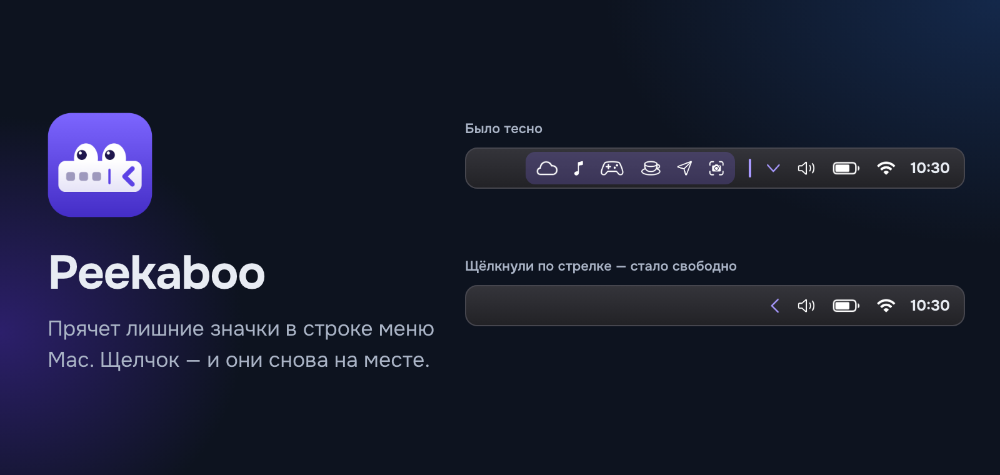
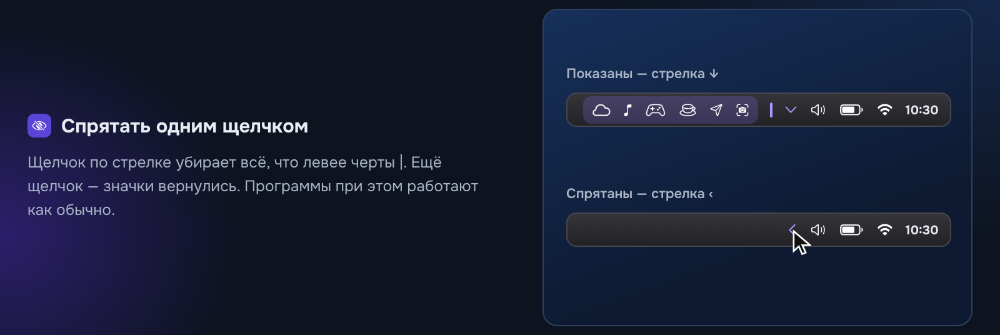
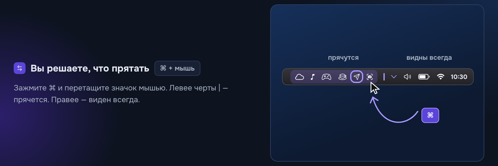
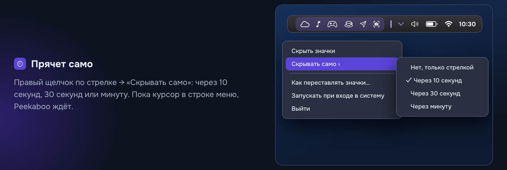

<p align="center"></p>

<h1 align="center">Peekaboo</h1>

<p align="center"><b>Прячет лишние значки в строке меню Mac.</b><br>
Бесплатно, для Mac с macOS 14 Sonoma и новее. Без аккаунтов, рекламы и интернета.</p>

<p align="center"><a href="https://eglibyte.ee/peekaboo.html">Страница программы</a> · <a href="https://eglibyte.ee/ru/peekaboo.html">на русском</a> · <a href="https://eglibyte.ee/en/peekaboo.html">in English</a></p>



## Что это и зачем

Строка меню — это полоска вверху экрана. Почти каждая программа ставит туда свой значок, и скоро нужное среди них уже не найти.

Peekaboo (по-английски «ку-ку») убирает редкие значки за стрелку. Один щелчок, и они снова на месте. Что прятать, решаете вы.

## Что умеет







Если черта случайно окажется не с той стороны стрелки, Peekaboo не даст спрятать самого себя и подскажет, как поправить.

## Как установить

1. Откройте **Терминал**: Программы → Утилиты → Терминал.
2. Скопируйте туда эту строку и нажмите Enter:

   ```bash
   curl -fsSL https://raw.githubusercontent.com/Egrom92/peekaboo/main/install.sh | bash
   ```

3. Готово: в строке меню появились стрелка и черта │, рядом открылась короткая подсказка.

Если появится окно с предложением установить инструменты Apple, нажмите «Установить», подождите 5–15 минут и повторите шаг 2. Это бесплатно и нужно один раз.

## Как пользоваться

| Что сделать | Как |
|---|---|
| Спрятать значок | зажмите ⌘ и перетащите его левее черты │ |
| Вернуть значок насовсем | зажмите ⌘ и перетащите его правее черты |
| Спрятать или показать всё | щёлкните по стрелке: ‹ — спрятаны, ↓ — показаны |
| Открыть меню | правый щелчок по стрелке или щелчок по черте |
| Прятать само | меню → «Скрывать само» |
| Посмотреть подсказку | меню → «Как переставлять значки…» |
| Не запускать при включении Mac | меню → «Запускать при входе в систему» |

Стрелку и черту тоже можно двигать с зажатой ⌘. Главное, чтобы черта была левее стрелки.

## Частые вопросы

**Спрятанные программы работают?** Да, как обычно. Прячется только значок.

**Почему двигать нужно с ⌘?** Так устроена macOS: этой клавишей переставляются любые значки в строке меню.

**У моего Mac вырез в экране.** Если значков много, часть уходит за вырез. Спрячьте лишние, и остальным хватит места.

**Peekaboo что-нибудь читает или отправляет?** Нет. Он не просит разрешений и не выходит в интернет.

## Обновить или удалить

**Обновить:** повторите команду установки.

**Удалить** (спрятанные значки снова станут видны):

```bash
curl -fsSL https://raw.githubusercontent.com/Egrom92/peekaboo/main/uninstall.sh | bash
```

## Другие программы

- [2pic](https://eglibyte.ee/ru/2pic.html) — скриншоты и видео с экрана
- [Oops](https://eglibyte.ee/ru/oops.html) — исправляет текст, набранный не в той раскладке
- [Magpie](https://eglibyte.ee/ru/magpie.html) — помнит всё, что вы копировали
- [Lark](https://eglibyte.ee/ru/lark.html) — звук, микрофон и пауза для всего, что играет

Все программы: [eglibyte.ee/ru/tools.html](https://eglibyte.ee/ru/tools.html)

<sub>Бесплатно, лицензия [MIT](LICENSE).</sub>
