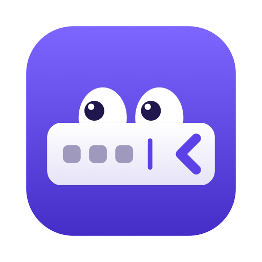

<p align="center"></p>

# Peekaboo

Прячет лишние значки в строке меню Mac. Значки, которые нужны раз в день, уходят за стрелку. Один щелчок, и они снова на месте и работают как обычно. Без аккаунтов, без рекламы, без доступа к интернету и без особых разрешений macOS. Бесплатно, macOS 14 Sonoma и новее.

**Страница программы:** [eglibyte.ee/peekaboo.html](https://eglibyte.ee/peekaboo.html)

Значки показаны (стрелка ↓), подсвечены те, что прячутся:


Значки спрятаны (стрелка ‹):


## Что умеет

- **Прячет значки одним щелчком.** Щелчок по стрелке убирает всё, что левее черты │, ещё щелчок возвращает.
- **Вы сами решаете, что прятать.** Значки расставляются мышью с зажатой ⌘. Это обычный способ macOS, Peekaboo просто прячет всё, что оказалось левее черты.
- **Прячет само**, если хотите: через 10 секунд, 30 секунд или минуту после того, как вы открыли значки. Пока курсор в строке меню, ждёт.
- **Не даёт спрятать сам себя.** Если черта случайно оказалась правее стрелки, Peekaboo не станет прятать значки и подскажет, как это поправить.
- **Запускается сам** при входе в систему, без значка в Dock.

## Установка

Одна команда в Терминале (Программы → Утилиты → Терминал):

```bash
curl -fsSL https://raw.githubusercontent.com/Egrom92/peekaboo/main/install.sh | bash
```

Если на Mac нет бесплатных инструментов разработчика Apple, откроется окно их установки. Нажмите «Установить», подождите 5–15 минут и запустите команду ещё раз. Xcode не нужен. Peekaboo соберётся на вашем Mac, встанет в «Программы» и запустится.

При первом запуске все значки показаны и открыта короткая подсказка: расставьте значки и нажмите на стрелку.

**Обновить** — та же команда. **Удалить** (спрятанные значки снова станут видны):

```bash
curl -fsSL https://raw.githubusercontent.com/Egrom92/peekaboo/main/uninstall.sh | bash
```

## Как пользоваться

В строке меню две метки Peekaboo: стрелка и тонкая черта │ слева от неё.

| Что | Как |
|---|---|
| Спрятать значок | зажмите ⌘ и перетащите его левее черты │ |
| Вернуть значок в постоянные | зажмите ⌘ и перетащите его правее черты |
| Спрятать или показать | щелчок по стрелке: ‹ — спрятаны, ↓ — показаны |
| Меню Peekaboo | правый щелчок по стрелке (или ⌥-щелчок, или щелчок по черте) |
| Прятать само | меню → «Прятать само»: только стрелкой, через 10 секунд, 30 секунд или минуту |
| Подсказка | меню → «Как переставлять значки…» |
| Запуск при входе | меню → «Запускать при входе в систему» |

Черту и стрелку тоже можно двигать с зажатой ⌘, например чтобы Peekaboo стоял в самом краю. Главное, чтобы черта оставалась левее стрелки.

## Частые вопросы

**Почему значки надо двигать с ⌘?** Так macOS разрешает переставлять значки в строке меню. Программы не могут двигать чужие значки сами, а Peekaboo и не пытается: ему достаточно знать, где черта.

**Спрятанные значки работают?** Да, программы продолжают работать как обычно. Покажите значки стрелкой, и ими можно пользоваться.

**На Mac с вырезом в экране** часть значков может уйти за вырез, если их слишком много. Это ограничение macOS. Спрячьте больше значков, и остальным хватит места.

**Peekaboo что-нибудь отправляет или читает?** Нет. Ему не нужны ни интернет, ни разрешения macOS: он управляет только двумя своими метками в строке меню.

## Как это устроено

Peekaboo добавляет в строку меню два своих элемента: стрелку и черту. Когда значки спрятаны, черта растягивается на 10 000 точек и выталкивает за левый край экрана всё, что стоит левее неё. Когда значки показаны, черта снова узкая. Положение меток macOS запоминает сама.

## Для разработчиков

- Swift Package (AppKit), без зависимостей, один файл [`Sources/Peekaboo/main.swift`](Sources/Peekaboo/main.swift).
- `./install.sh` из папки проекта собирает и ставит текущую версию. `./scripts/build.sh` только собирает `build/Peekaboo.app`.
- Значок рисует [`scripts/make-icon.swift`](scripts/make-icon.swift), картинки для этого описания — [`scripts/make-demo.swift`](scripts/make-demo.swift).

## Лицензия

MIT — см. [LICENSE](LICENSE).
